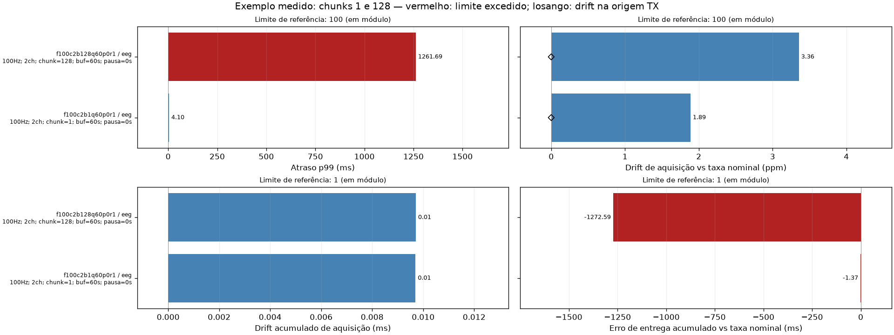

# Exemplo medido: chunks 1 e 128

Observação ingênua: sem compensar atraso, alinhar inícios ou corrigir a reconstrução.
Timestamps de aquisição corrigidos pelo LSL são separados dos tempos de leitura; o atraso de entrega é preservado.

| Caso | Condições: Hz / canais / chunk / buffer / pausa | Atraso p99 (ms) | Drift aquisição (ppm) | Acúmulo aquisição (ms) | Desvio entrega (ms) | Perdas | Indicações |
| --- | --- | --- | --- | --- | --- | --- | --- |
| f100c2b128q60p0r1 / eeg | 100 / 2 / 128 / 60s / 0s | 1261.69 | 3.36 | 0.01 | -1272.59 | 0 | atraso, jitter, entrega variável |
| f100c2b1q60p0r1 / eeg | 100 / 2 / 1 / 60s / 0s | 4.10 | 1.89 | 0.01 | -1.37 | 0 | entrega variável |

**Drift injetado:** zero em todos os casos.

Desvio de entrega inclui filas, fase dos chunks, pausas e agendamento: não é drift puro de relógio.
Drift de aquisição RX é estimado dos timestamps LSL corrigidos contra a taxa nominal; ruído de correção pesa em testes curtos.
O losango mostra o drift medido nos timestamps de origem; o CSV guarda as duas estimativas.
Acúmulo é a diferença temporal desde a primeira amostra pareada, não a soma dos atrasos.
(!) marca drift de aquisição acima do limite. Os valores são estimativas; nenhum limite excedido não prova sincronização.
O CSV também inclui jitter, variação de atraso, erro de amplitude e duração de cada caso.

Duração: 4 s por caso, mesma máquina, sem drift injetado. Uma execução por condição; não é caracterização de longo prazo.

Outros exemplos anteriores: [drift injetado crescente](figuras/drift_crescente.png), [perdas e pausas](figuras/eeg_extremo.png), [EEG normal](figuras/eeg_normal.png), [marcadores](figuras/sync_extremo.png).
