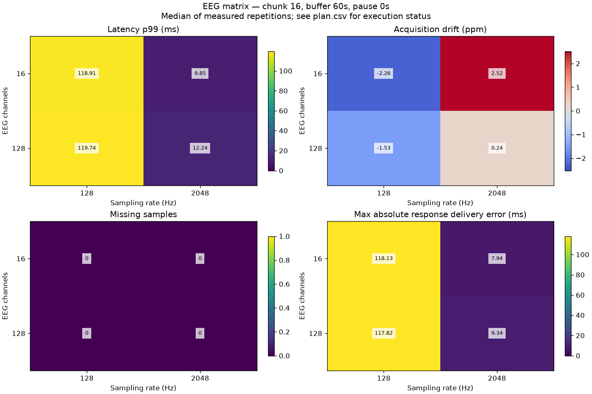
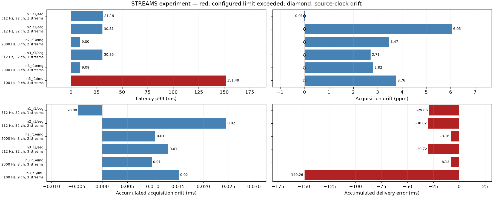
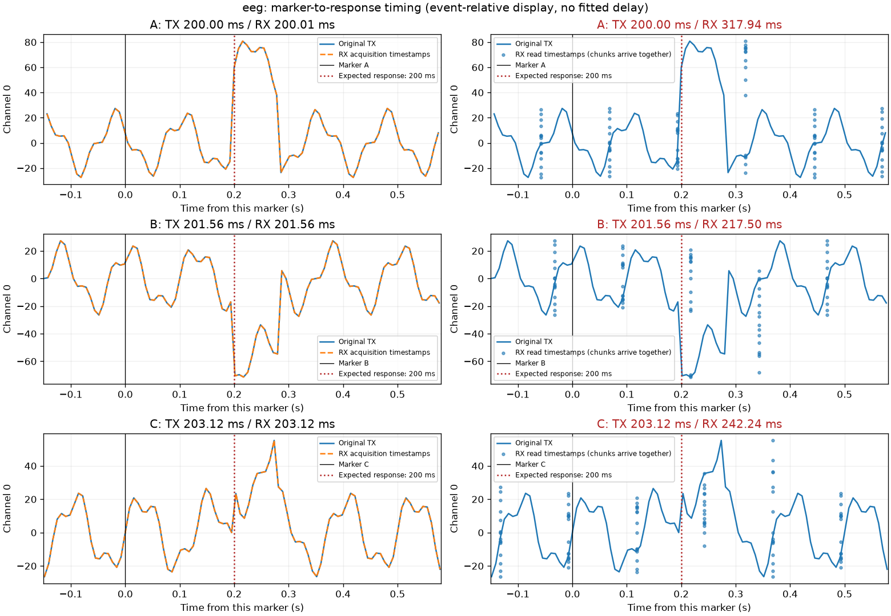
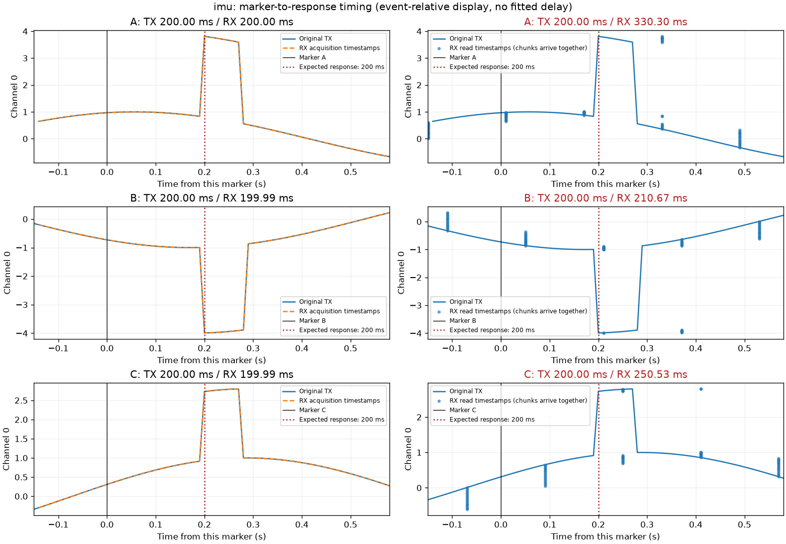
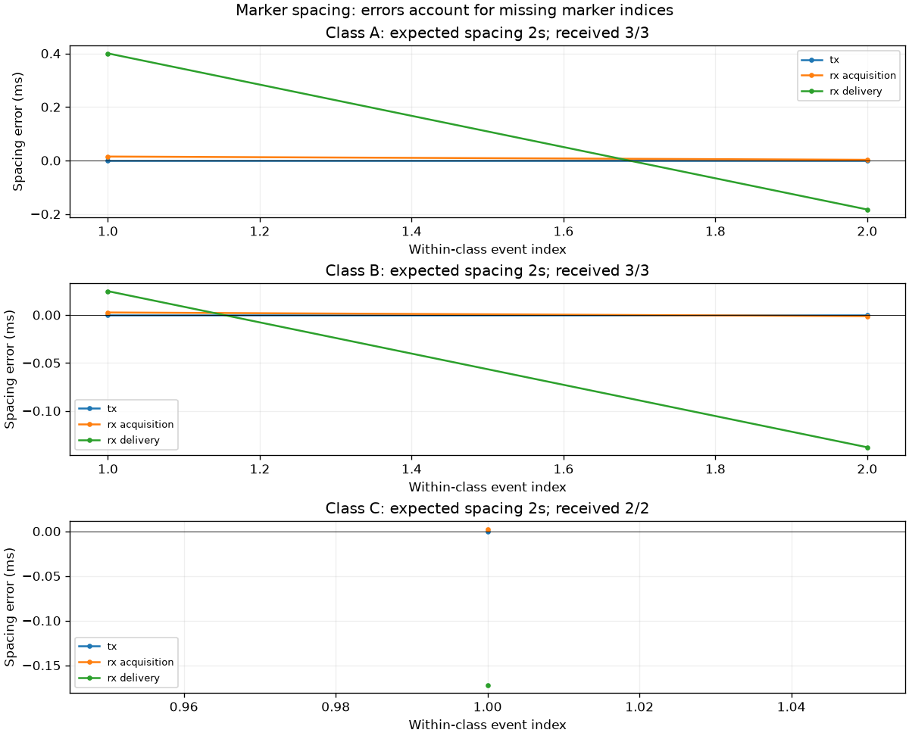

# Measured examples

Representative local validation: **4 EEG matrix corners + 3 incremental-stream stages**, 3 seconds per stream, no injected drift.
All seven cases completed without missing samples. Two additional focused checks validated exact counts and five-second marker spacing; all nine runs are listed in plan.csv. The full default 20-cell EEG matrix was not run.

[Executed case list](plan.csv) · [EEG measurements](eeg_summary.csv) · [Stream measurements](streams_summary.csv)

## EEG matrix

Tested: 16/128 channels × 128/2048 Hz; chunk 16; buffer 60 s; no artificial pauses.

## Incremental streams

1. EEG: 512 Hz, 32 channels.
2. Add EMG: 2000 Hz, 8 channels; EEG stays unchanged.
3. Add IMU: 100 Hz, 9 channels; EEG and EMG stay unchanged.

## Marker-to-response intervals

A/B/C markers repeat every 2 s, starting at 0.3/0.9/1.5 s. Each causes a visible response 200 ms later.
The table uses the first observed event from each class. Values come from waveform onset detection.

| Stream / class | Expected (ms) | Original TX (ms) | RX acquisition (ms) | RX availability (ms) |
| --- | --- | --- | --- | --- |
| eeg / A | 200.00 | 200.00 | 200.01 | 317.94 |
| eeg / B | 200.00 | 201.56 | 201.56 | 217.50 |
| eeg / C | 200.00 | 203.12 | 203.12 | 242.24 |
| imu / A | 200.00 | 200.00 | 200.00 | 330.30 |
| imu / B | 200.00 | 200.00 | 199.99 | 210.67 |
| imu / C | 200.00 | 200.00 | 199.99 | 250.53 |

The marker-spacing plot uses an additional five-second, three-stream check so all three classes repeat. All classes retained their 2-second spacing in the acquisition timestamps.

An additional exact-count run received 257/257 samples on each of EEG, EMG and IMU. Responses after a stream ended were marked outside_recording.
These are short software simulations. Acquisition timestamps can reconstruct the waveform correctly while read-time availability is delayed by chunks. No delay correction was applied.

Validation: 32 unit tests passed. The default 23-case campaign has not been executed in full.
